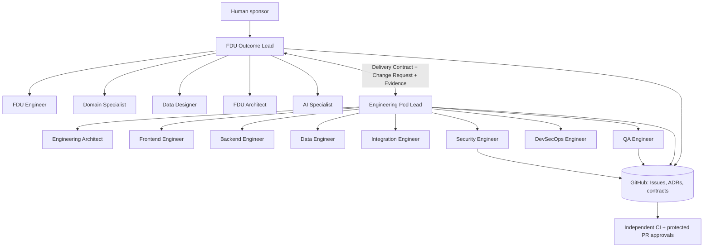
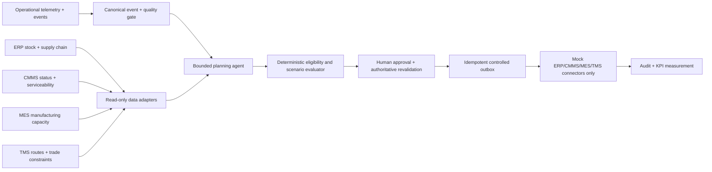

# Architecture and ownership

## Delivery system (15 existing agents)

Leads alone initiate ordinary cross-team messages. Keep leads **unsandboxed but non-executing** (deny host exec, process, filesystem writes, browser and Gateway tools) to avoid OpenClaw’s default sandbox session-tools clamp blocking cross-lead sends. All specialists are sandboxed in isolated workspaces; verify live routing. Do not relax the global sandbox clamp to make lead messages work. Their specialists work through lead-owned delegated tasks and repository artifacts. **GitHub is durable state; sessions are ephemeral context.** The pod lead may reject an insufficient contract but cannot unilaterally change its authorized scope. FDU may reject delivered work on objective acceptance evidence but cannot merge or release code.

### Routing matrix

| Requester | `sessions_spawn` target | Ordinary `sessions_send` destination | Ownership |
|---|---|---|---|
| Outcome Lead | FDU Engineer, Domain Specialist, Data Designer, FDU Architect, AI Specialist | Engineering Pod Lead | Business and acceptance |
| Pod Lead | Engineering Architect, Frontend, Backend, Data, Integration, Security, DevSecOps, QA | Outcome Lead | Engineering execution |
| All other specialists | None | None | Only assigned bounded task |

The two leads deliberately run with `sandbox.mode: off` AND an explicit deny for host tools (read/write/edit/exec/process/browser/Gateway). Sandboxed callers are constrained by the default spawned-only session clamp, which otherwise blocks the lead-to-lead send-only route. Specialists run in per-session Docker sandboxes with no network. Audit all effective tool grants and plugins before use.

Native spawned children may still be reachable by their parent through their own subagent tree; ordinary cross-agent messaging rules and inherited isolation are distinct controls. Never rely on prompts alone to restrict cross-agent access. Do not allow agents to create new agents or escalate tools without explicit human approval.

### Delivery states

`INTAKE → DISCOVERY → DESIGN_REVIEW → READY_FOR_BUILD → IN_PROGRESS → VERIFYING → RELEASE_READY → RELEASED → OUTCOME_VALIDATED`

Exception states `BLOCKED`, `REWORK`, `CANCELLED`. Every move requires owner, provenance and policy-checked evidence. `OUTCOME_VALIDATED` is not synonymous with passing tests.

### Work products

- `DeliveryContract` (FDU, versioned, approved): scope/outcome, data/API contracts, eligibility rules, NFRs, risk and testable criteria.
- `TaskPacket` (Pod Lead): bounded work and tools, dependency, timeout, stop conditions, contract version.
- `EvidencePacket` (author plus independent reviewers): actual PR, CI, test/security results, residual risk.
- `DecisionRecord` (approved): significant tradeoffs, human decider, change impact.
- `GitHub Issue/PR`: primary backlog, execution state, commit/CI links. Do **not** treat model chat text as durable state.

## Pilot product runtime (separate from delivery-agent organization)

The runtime planning agent suggests scenarios, fills explicit fields and explains tradeoffs. Deterministic validators verify business rules, inventory freshness, safety/certification, customs/trade checks, and policy. Use explicit, versioned adapter contracts; the model is not a source of operational truth. Full production adapters are out of scope.

### Scope-limited MVP user story

**As** a global equipment fulfillment planner, **when** a tool health/usage insight or customer demand indicates a future requirement, **I want** a grounded delivery scenario that considers approved inventory and maintenance readiness and a manufacturing fallback, **so that** a human can approve a simulated fulfillment sequence and assess feasibility.

**In scope**: synthetic asset event, normalized equipment demand, inventory and maintenance eligibility, a cross-border route, manufacturing-fallback recommendation, explainable option ranking, planning approval, mock reservation/dispatch, idempotency and audit, basic dashboard/report from mock state.

**Out of scope**: autonomous real-world inventory moves, purchasing, shipment booking, customs entry, sanctions or export decisions, manufacturing orders, customer promises, repairs, safety-critical interventions, and unmanaged international data transfers.

### Operational data quality and fallback

- Identity match: globally unique asset + SKU/serial mapping and customer/site key, verified against authoritative registry.
- Time: UTC with original offset and freshness policy; order late/duplicate events and reconcile out-of-order observations.
- Units: explicit units and conversions with validated lookup (no speculative transformations).
- Quality: block stale/low-confidence/missing telemetry; present reason and request human review.
- Inventory: quantities must include `as_of`, reservation state and location; revalidate immediately before commit.
- Maintenance: hold, certification, return-to-service are authoritative and may not be waived by AI.
- International: trade/export/sanctions/licensing, tax, customs, incoterms, transport restrictions and customer-specific conditions are gates, not LLM-generated approvals.
- Integration: use transactional outbox, correlation IDs and idempotency keys; never retry uncertain non-idempotent writes blindly.

### Success metrics (targets must be baselined)

| Metric | Initial measurement |
|---|---|
| Time to proposed fulfillment plan | Trigger received → policy-eligible plan displayed |
| First-pass plan eligibility | Eligible plans / all generated plans |
| Simulated on-time delivery feasibility | Plans with ETA ≤ customer need-by / approved plans |
| Planning automation rate | Mock demand cases producing plans without operator data corrections |
| Exception containment | Stale/held/uncleared cases correctly blocked |
| Duplicate side effects | 0 in repeated mock dispatch attempts |
| Human approval compliance | 100% writes require independent recorded authorization |

No percentage or time improvement should be claimed until measured against a representative baseline.
